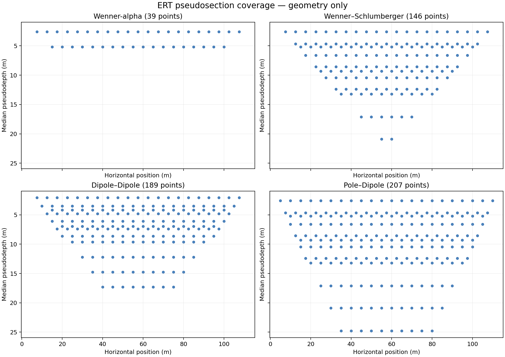

# ERT Pseudosection Lab

**Automated Electrical Resistivity Tomography survey geometry, median-depth estimates and interactive pseudosection plotting.**

A Python/Streamlit project covering four electrode arrays: **Wenner-alpha, Wenner–Schlumberger, Dipole–Dipole and Pole–Dipole**. Built as a reproducible educational survey-design tool, with transparent equations and validated CSV measurements.



> **Scientific scope:** This tool designs collinear, equally spaced electrodes on a flat surface and assigns **theoretical median pseudodepths** using published coefficients for a homogeneous half-space. It does **not** calculate true geological depth, a subsurface sensitivity map, a layered-earth forward response or 2-D resistivity inversion.

## Features

- Generate electrode IDs and positions for A, B, M, N with array-specific geometry.
- Control **electrode interval**, **dipole/electrode separation `a`**, and separation factor **`n`** (1–6).
- Pole–Dipole **forward, reverse or both**; ideal remote return electrode B.
- Calculate the **signed geometric factor** for every arrangement using a general four-electrode equation.
- Calculate **median pseudodepth** using published Loke/Edwards coefficients—no invented extrapolations.
- Interactive pseudosection scatter plot, 2-D point-count density heatmap, and inspection of one electrode arrangement.
- Four-array comparison with data count, maximum assigned pseudodepth and active span.
- Export survey CSV, plot PNG, interactive HTML and comparison charts.
- Optionally populate readings with an **ideal homogeneous-half-space analytical example** (known uniform resistivity).
- Upload a completed, geometry-matched CSV with **apparent resistivity** or **signed voltage and current**; validate identifiers and signs.
- CLI batch generator, reproducible example CSVs, unit tests and GitHub Actions testing workflow.

## Folder structure

```text
ert-pseudosection-lab/
├── app.py                          # Streamlit interface (entry point)
├── pyproject.toml                  # Installable Python package
├── requirements.txt                # Streamlit Cloud dependencies
├── requirements-dev.txt            # Test dependencies
├── README.md
├── .gitignore
├── .streamlit/config.toml
├── .github/workflows/tests.yml
├── assets/four_array_coverage.png  # Example plot displayed on GitHub
├── examples/
│   ├── wenner_blank_template.csv
│   └── wenner_100_ohm_m_example.csv
├── src/ert_pseudosection/
│   ├── __init__.py
│   ├── geometry.py                 # Electrode generation, K, median depth, CSV checks
│   ├── plots.py                    # Plotly + Matplotlib plotting/export
│   └── cli.py                      # Batch export
└── tests/test_geometry.py
```

## Start on Windows (PowerShell)

Use **Python 3.11** (recommended). Open PowerShell inside the unzipped `ert-pseudosection-lab` folder:

```powershell
py -3.11 -m venv .venv
.\.venv\Scripts\python.exe -m pip install -r requirements.txt
.\.venv\Scripts\python.exe -m streamlit run app.py
```

The web app opens locally (usually `http://localhost:8501`). This uses the virtual environment's Python directly, so you **do not** need to change PowerShell execution policy.

### Run unit tests

```powershell
.\.venv\Scripts\python.exe -m pip install -r requirements-dev.txt
.\.venv\Scripts\python.exe -m pytest -q
```

### Generate CSV and PNG files without opening the app

```powershell
.\.venv\Scripts\python.exe -m ert_pseudosection.cli --electrodes 24 --spacing 5 --max-a 2 --max-n 6 --output outputs
```

To include the **analytical homogeneous example** of 100 Ω·m with 0.1 A injected current:

```powershell
.\.venv\Scripts\python.exe -m ert_pseudosection.cli --electrodes 24 --spacing 5 --max-a 2 --max-n 6 --resistivity 100 --current 0.1 --output outputs
```

The command generates four CSV files, their respective PNG pseudosections, a comparison PNG and `summary.csv` inside `outputs/` (excluded from Git).

## Mathematical model and survey definitions

### Apparent resistivity and geometric factor

For collinear electrodes on a flat surface of a homogeneous, isotropic half-space:

\[
\rho_a = K\frac{\Delta V}{I},\quad \Delta V=V_M-V_N,
\qquad K=\frac{2\pi}{1/AM-1/AN-1/BM+1/BN}.
\]

`K` is **signed**, not automatically made positive. For ordered dipole–dipole `A–B–M–N`, both `K` and the ideal `ΔV` are negative, giving positive `rho_a`. When B is infinitely remote, `1/BM = 1/BN = 0`, as assumed for Pole–Dipole. The program outputs both `k_signed_m` (use to compute resistivity) and `k_magnitude_m` (magnitude for comparison).

Distances are in metres, current in amperes, voltage in volts and resistivity in Ω·m. The electrode numbers in CSV columns ending in `_idx` are **zero-based**. `B_idx = -1` means the ideal remote electrode; `x_B_m` is blank for it.

| Array | Electrode order | Distances | Expected magnitude of `K` |
|---|---|---|---|
| Wenner-alpha | A–M–N–B | AM=MN=NB=a | 2πa |
| Wenner–Schlumberger | A–M–N–B | AM=NB=na, MN=a | πn(n+1)a |
| Dipole–Dipole | A–B–M–N | AB=MN=a, BM=na | πn(n+1)(n+2)a |
| Pole–Dipole | A–M–N (or reverse) | AM=na, MN=a, B remote | 2πn(n+1)a |

`a = a_multiplier × electrode_interval`. For Wenner-alpha, the multiplier directly increases all three equal spacings; `n` is kept at 1. For the other arrays, `n` is varied independently over 1...`max_n`.

### Assigned pseudodepth

The plot position is the midpoint of the **active finite electrode span**. The vertical position uses the Edwards median-depth convention with the **published, rounded** `z_e/a` factors tabulated by Loke (1999), Table 2. For example, for Wenner-alpha `z_e = 0.519a`. For Dipole–Dipole, `n = 1,2,3,4,5,6` gives `z_e/a = 0.416, 0.697, 0.962, 1.220, 1.476, 1.730`. Wenner–Schlumberger and Pole–Dipole use `0.520, 0.930, 1.320, 1.710, 2.090, 2.480` for `n = 1...6`.

The coefficient at `n=1` for Wenner–Schlumberger is tabulated as 0.520, whereas Wenner-alpha is 0.519. This is published **rounding**, not a different physical depth for identical geometry. The code reproduces the tabulated values as written. Do not extend these tables to `n > 6` without a documented model or additional primary-source values.

**A median-depth plotting position is neither the position of the electrical current path nor a measured geological boundary.** Actual field DOI varies with resistivity contrasts, noise, topology/topography, electrode contact and inversion sensitivity.

### CSV upload

1. In **Survey designer → Upload readings CSV**, download the matching **blank CSV template**.
2. Leave `measurement_id`, `A_idx`, `B_idx`, `M_idx`, and `N_idx` exactly as generated. All rows must be retained; blank reading rows are allowed.
3. Fill **either** `apparent_resistivity_ohm_m` **or both** `voltage_v` (signed **V_M − V_N**) and `current_a` (positive).
4. Upload it. The app checks every geometry ID and calculates `rho_a = K*voltage/current` where needed. Incorrectly signed voltages, duplicate IDs, missing half-pairs and mismatched geometry are rejected.

`examples/wenner_blank_template.csv` and `examples/wenner_100_ohm_m_example.csv` are for **24 electrodes at 5 m**, max-a multiplier 2. Match those settings before trying to upload the example CSV. The sample values are generated analytically for a *uniform* 100 Ω·m half-space, not field readings.

## GitHub and Streamlit Community Cloud

### Upload to GitHub

1. On [GitHub](https://github.com/new), create a **public** repository named `ert-pseudosection-lab` (do not add an initial README or `.gitignore`, since they are in the project already).
2. Open PowerShell in the unzipped project folder and run:

```powershell
git init
git add .
git commit -m "Initial ERT pseudosection lab"
git branch -M main
```

3. On the GitHub page for the empty repository, copy **its actual HTTPS remote URL**, then run:

```powershell
git remote add origin <paste-your-repository-HTTPS-URL-here>
git push -u origin main
```

`<paste-your-repository-HTTPS-URL-here>` is the **one required replacement**; for example, your own `https://github.com/USERNAME/ert-pseudosection-lab.git`. GitHub authentication may ask you to sign in.

### Deploy to Streamlit

1. Open [Streamlit Community Cloud](https://share.streamlit.io/) and sign in with GitHub.
2. Choose **Create app**, then your repository, the `main` branch, and the entry point `app.py`.
3. Deploy. Streamlit reads the root `requirements.txt` and installs this package and its dependencies.

The app needs no API key, database, `.env` file or external datasets. The CSV and PNG downloads are calculated from settings; the app does not upload user data to an external server by itself.

## Scientific limitations and responsible language

- **Geometry-only mode** shows assigned observation points, not a subsurface resistivity image.
- A **point-count heatmap** counts plotting locations and is **not** a sensitivity kernel, cell coverage by rays, or a resolution map.
- The **homogeneous analytical example** is a sanity check, not a realistic synthetic response for layers, faults, groundwater or a buried target.
- **Theoretical median pseudodepth** does not prove actual depth of investigation at an individual field site.
- The Pole–Dipole return electrode is treated as **ideally remote**; a real finite-distance B changes K and potentially the result.
- There is no **forward solution for heterogeneous ground**, no inversion, and no 3-D topographic model.
- Real field datasets may use irregular electrode coordinates or file formats requiring a separate import adapter.

A sensible advanced extension is reading field survey files (for example instrument exports), applying reciprocal/error filtering, and comparing with a physics-based forward solver (such as pyGIMLi) and inversion results.

## Sources (primary methodology and authoritative technical sources)

1. Loke, M. H. (1999), *Electrical imaging surveys for environmental and engineering studies: A practical guide to 2-D and 3-D surveys*, **Table 2** and Sections 2.3, 2.5. https://www.geometrics.com/wp-content/uploads/2018/10/Lokenote.pdf
2. Edwards, L. S. (1977), *A modified pseudosection for resistivity and IP*, *Geophysics*, DOI: https://doi.org/10.1190/1.1440762
3. U.S. Environmental Protection Agency, *Electrical Resistivity* (survey physics and DOI limits): https://www.epa.gov/environmental-geophysics/electrical-resistivity
4. pyGIMLi, reference ERT electrode array patterns: https://www.pygimli.org/_modules/pygimli/physics/ert/ertScheme/

The program's implementation is independent of pyGIMLi; pyGIMLi is cited only as an external scheme comparison and a possible future integration.
